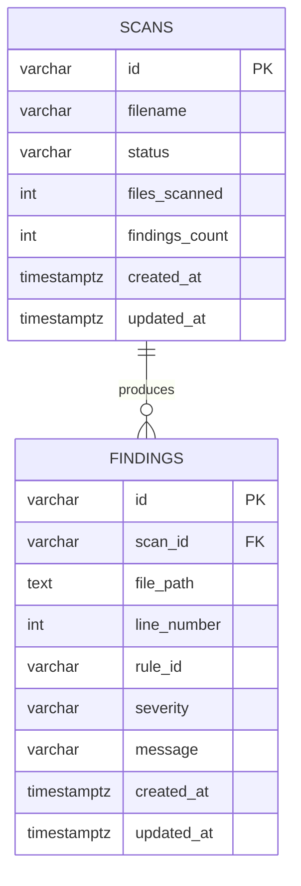

# Entity Relationship Diagram


## DBML
```dbml
Table scans {
  id varchar(36) [pk]
  filename varchar(255) [not null]
  status varchar(32) [not null]
  files_scanned int [not null]
  findings_count int [not null]
  created_at timestamptz [default: `now()`]
  updated_at timestamptz [default: `now()`]
}
Table findings {
  id varchar(36) [pk]
  scan_id varchar(36) [not null, ref: > scans.id]
  file_path text [not null]
  line_number int [not null]
  rule_id varchar(60) [not null]
  severity varchar(12) [not null]
  message varchar(255) [not null]
  created_at timestamptz [default: `now()`]
  updated_at timestamptz [default: `now()`]
}
```
